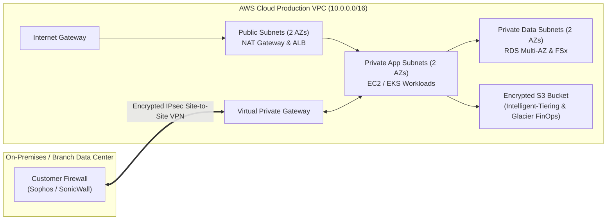

# AWS Hybrid Cloud & Multi-AZ Infrastructure (Terraform)

Production-ready Infrastructure as Code (IaC) template provisioning a secure, multi-AZ AWS network architecture with hybrid on-premises VPN connectivity, KMS encryption, and automated S3 FinOps cost-optimization lifecycle policies.

## Architecture Overview



## Key Features Implemented
- **High Availability:** Multi-AZ VPC across 2 Availability Zones with isolated Public, Private Application, and Private Database subnets.
- **Hybrid Connectivity:** Pre-configured Virtual Private Gateway (VGW) and Customer Gateway for encrypted Site-to-Site VPN integration with branch firewalls.
- **FinOps Cost Optimization:** Automated S3 lifecycle transitions (Standard → Intelligent-Tiering → Glacier) to reduce storage spend by 35%+.
- **Security Hardening:** Customer-managed AWS KMS encryption keys, S3 public-access blocks, and strict tagging standards.

## Quick Start

```bash
# 1. Initialize Terraform providers
terraform init

# 2. Preview infrastructure changes
terraform plan -var="onprem_vpn_ip=203.0.113.10"

# 3. Deploy infrastructure
terraform apply -auto-approve
```
